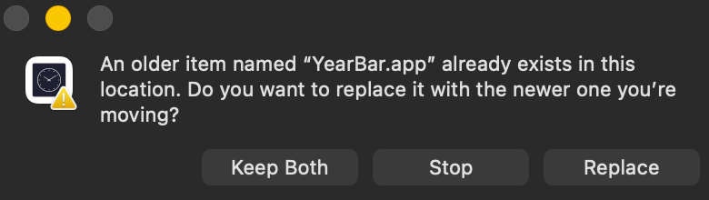
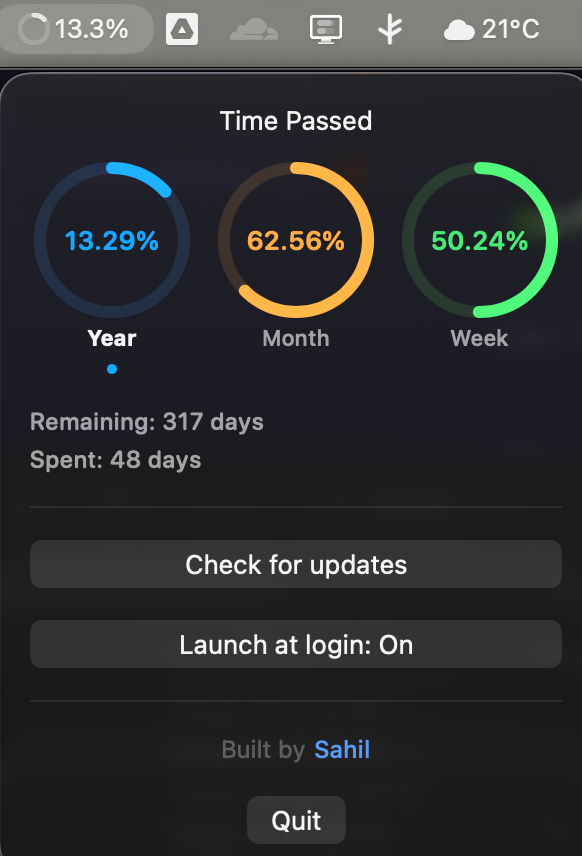

# YearBar
<details>
  <summary><h2>just why?</h2></summary>
  <p>I wanted a simple app which could show me how much of the year is left (it helps me realise how quickly time is passing since i still feel like its 2022 and college is about to start. PS - im about to graduate in a few months 😔). 
  
  All existing apps like this are paid, so I decided to vibecode my own app.</p>
</details>
 

## what is it
A menu bar / system tray app that shows how much of the year has passed.

Displays a live progress percentage with a circular ring icon. Click it to see year, month, and week progress at a glance.

**Linux (Noctalia / niri):** see [`linux/noctalia/yearbar/README.md`](./linux/noctalia/yearbar/README.md) — bar capsule + Mac-style rings panel. Shared math lives in [`core/`](./core/).

**Windows (Tauri tray):** see [`windows/README.md`](./windows/README.md) — Mac-matching popup in the notification area, same shared [`core/`](./core/) math.

## what it can do

- Year progress percentage in the menu bar / tray, updates every 60 seconds
- Dropdown with circular progress bars for year, month, and week
- No Dock / taskbar window: lives in the menu bar (macOS) or system tray (Windows)

## installation

### macOS

1. Download `YearBar.zip` from [Releases](https://github.com/sahiwl/YearBar/releases)
2. Unzip and drag `YearBar.app` to `/Applications`
3. First launch: right click the app → Open → Open (macOS blocks unsigned apps by default)

Requires macOS 13+.

### Windows

1. Download `YearBar_x.y.z_x64-setup.exe` from [Releases](https://github.com/sahiwl/YearBar/releases)
2. Run it. The installer isn't code-signed yet, so Windows shows **"Windows protected your PC"** → click **More info** → **Run anyway**
3. YearBar appears in the system tray (check the `^` overflow and drag it onto the taskbar)

Requires Windows 10/11.

**Blocked with no "Run anyway"?** That's Smart App Control, which only allows signed apps. It's on for some clean Windows 11 installs. You can turn it off in Windows Security → App & browser control → Smart App Control settings (recent Windows 11 updates let you turn it back on afterwards), or wait for a signed release.


**<h2>Updating:</h2>** If you already have YearBar and drag a new version into Applications, macOS will ask to replace the existing app. Click **Replace** to update. 

Do not click **Keep Both** as it will create 2 copies of YearBar creating confusion. 


## preview
here's what it looks like:



## build from source

### macOS

```bash
xcodebuild -project YearBar.xcodeproj -scheme YearBar -configuration Release -derivedDataPath build clean build
```

The `.app` will be at `build/Build/Products/Release/YearBar.app`.

### Windows

Requires Node.js LTS, Rust (`rustup`), and WebView2.

```powershell
cd windows
npm install
npm run tauri build
```

Installers are written under `windows/src-tauri/target/release/bundle/` (NSIS `.exe` and MSI). For day-to-day work use `npm run tauri dev`.

